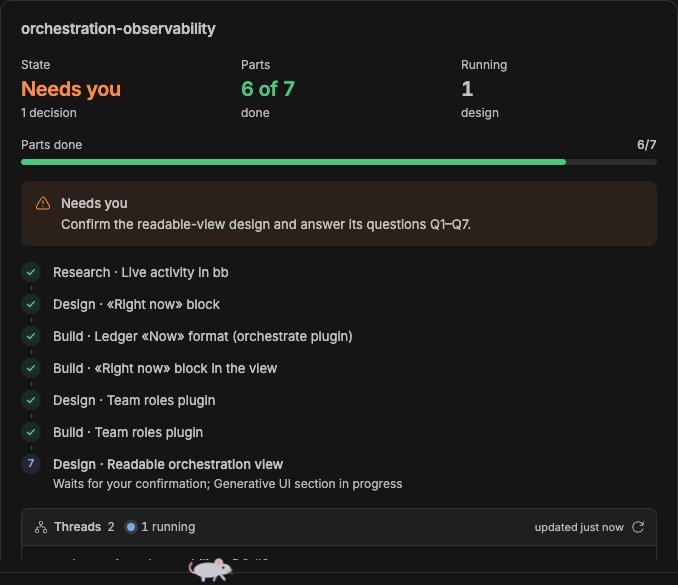
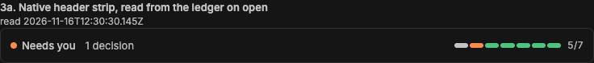
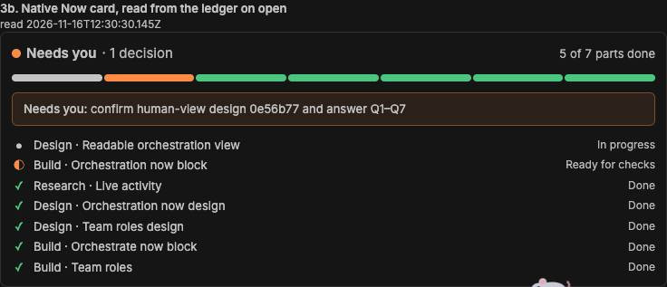

# A human-readable Orchestration view

Status: draft for the owner's confirmation. Builds on [now-block.md](now-block.md), which landed as
the «Right now» block (0d8700c). Mockup: [human-view-mockup.html](human-view-mockup.html), and the
ASCII version in section 4. Generative UI: section 6, with its prototypes in
[prototypes/](prototypes/).

## Problem

The owner, after looking at the landed «Right now» block (2026-11-16): «The format that Ledger writes
is really not understandable. It's really weird. Need to format it for the human representation
because this panel for orchestration is for humans. It's for some kind of brief, for introduction,
and resolving problems without getting into the chat. So it would actually need to make the
orchestration view and these blocks really UX and UI friendly for developers, just to be able to see
in the first glance the current state, and that's it.»

The goal: a developer opens an orchestrator thread and sees, without reading the chat or ledger
syntax, **what the goal is, where it stands, what is running, what waits on them and how to resolve
it**.

## 1. What is unreadable today

All examples come from this orchestration's ledger
(`orchestrate/orchestration-observability.md`, read 2026-11-16, 271 lines) exported with the
installed orchestrate 0.17.0 exporter and passed through today's `summarizeExport` and `buildView`
(`src/ledger.ts`, `src/view.ts` at 0d8700c) with the real sidebar state of the orchestrator and this
designer thread. What the view model holds is what the screen shows.

### 1.1 The view repeats the ledger's own structure

Today the page shows, top to bottom: the goal, the «Right now» box, a phase label, the tab bar, a
heading with a subline, ask cards, Brief, Team and History. The current state is spread over four
places that each say it differently:

| Place | Text today, this ledger |
|---|---|
| Phase (`Recap.tsx:13`) | `Work in progress` and below it `active` (the header's raw `Status`) |
| Heading and subline (`OrchestrationTab.tsx:482-483`) | `Nothing needs you` · `1 agent running · 9 of 11 done · latest report 5m ago` |
| «Right now» header | `Right now … ledger written 8m ago` |
| «Right now» orchestrator line | `Orchestrator · idle since 1m` |

The «Right now» box is the ledger's key list rendered as a definition list: `Last turn`, `Doing`,
`Blocked by`, `Waits on`, `Next`, `Last decision`, `Checkpoint as written`, `Full last report`
(`NowBlock.tsx:116-123`). Each label is a ledger key, and each value is the orchestrator's
note-to-self, shown verbatim.

### 1.2 The checkpoint is a log, and the clamp shows its oldest part

This ledger has no structured block (its export: `structured: false`), so the box shows the free
text, clamped to three lines (`NowBlock.tsx:80`, owner's answer to now-block.md Q4):

> D1 landed 8f52057 (verified). I1 (ai-hub PR) and I2 (view) unblocked and working; I3 working on
> team-roles. I3 done (owner checked the page). I1 merged eeb9ce1, orchestrate 0.17.0 installed. Gate
> G-I2 landed 0d8700c (RV-I2 r2 approve; ff push 6e1b580..0d8700c; installed from path, running).
> Owner to look at the Right now block. I2 closed (ack #60, no working files), archived. Owner: view
> not human-readable → D3 design (thr_wgpp44h7xw, #61) …

The text is appended in time order, so the three visible lines are the oldest and say the opposite
of the current state («I2 … unblocked and working» — I2 is landed and closed). The current line is
behind «Show all». It also carries seven commit SHAs, two message numbers, a gate code, a thread id,
`ff push`, `r2`, `ack`.

### 1.3 «Last decision» is three hours old

`Last decision` shows `Archived 10 journal rows of orchestrator #1 to
history/orchestration-observability/journal-to-2026-11-16T1505.md`. The view takes the journal's last
row in file order (`src/ledger.ts:135`), but this journal puts new rows on top and older rows at the
bottom: the last row is from 16:02, the newest (19:10, the start of this design) is the first row.
Bookkeeping about archiving journal rows is not a decision a human cares about either.

### 1.4 Rows are named after branches, files and review targets

No «Subtasks» id cell in this ledger has a name (0 of 11), so each row falls back to its delivery
(`src/ledger.ts` `name: row.name ?? row.delivery`):

| Row | Name shown | Step shown |
|---|---|---|
| R1 | `report + thread-storage/thr_em67d6h8se/R1-live-activity.md` | `verified — facts spot-checked; copy in history/orchestration-observability/` |
| D1 | `bb-plugins feature/orchestration-now-design` | `verified — landed 8f52057 on main (rebased db1f783, doc identical); docs only, no after-l…` |
| D2 | `bb-plugins feature/team-roles-design (local commits, not pushed; reachable in…` | `verified — landed ae823e0 on main 2026-11-16T15:45+0300, doc only, no after-landing` |
| I1 | `kartollika-ai-hub PR from feature/orchestrate-now-block` | `verified — merged eeb9ce1 (PR #53 @5adb1fb); installed orchestrate 0.17.0; ack #51, worki…` |
| RV-I2 | `review report on I2 @7daf018` | `Briefed (#50)` |
| (none) | `orchestration-observability · D3 #1` | `Running, not in the ledger yet` |

- The ids (`R1`, `D1`, `RV-I2`) are the only label; nothing says that D means design or RV review.
- Reviewers are subtasks of their own: `9 of 11 done` counts five review sessions as parts of the
  work. A reader wants «6 of 7 parts», with the review as a stage of the part it reviews.
- This designer thread shows with an empty label and the thread title as its name, because its title
  ends in `D3 #1` and `childLabel` (`src/view.ts:393`) only accepts a bare `D3`.

### 1.5 The ledger is behind, and the view can't tell

The «Subtasks» table still says `I2 delivered — … gate: review` and `RV-I2 working — briefed (#50)`.
The decision journal says both closed and were archived (18:50, 18:55). The view trusts the table, so
I2 shows `Delivered, waiting for the gate` and RV-I2 shows as working: two parts look open that are
done. Both threads are archived; the view does not look.

### 1.6 Times run ahead of the clock

Ledger times say `19:10+0300 (host clock)` while the host clock and the ledger file's mtime said
15:13 at the same moment: the orchestrator wrote times about four hours ahead. Ages computed from
them are in the future, and the view drops them silently (`ageSince` returns `""`), so «Last
decision» and every wait lose their age without a word.

### 1.7 Ledger vocabulary in the owner's face

Words a reader meets in the view today that only the orchestrator protocol defines: `ack`, `#57`,
`r2`, `G-I2`, `RV-I2`, `@7daf018`, `ff push`, `thr_wgpp44h7xw`, `waiting on:`, `since:`, `for:`,
`(host clock)`, `briefed`, `delivered`, `gate`, `verified`, `after-landing`, `working files`,
`Checkpoint as written`. The structured block of now-block.md section 1 is no better when shown
verbatim: `doing: waiting — see «waiting on»; D2 drafting team-roles design`, `next: on R1's report:
send «unblocked» to D1 for sections 4–5`.

### Summary

Two causes, two layers of fix:

1. **The view shows structure instead of answers.** It renders the ledger's sections and keys
   instead of the five questions a reader has. Fixable in the view alone: layout, labels, names,
   status words, ordering, grouping, times, hiding ids (sections 2 and 3).
2. **The orchestrator writes prose for itself.** `doing`, `next`, `for:`, status notes and journal
   decisions are free text. The view can strip ids and SHAs from them, but it can't turn «on R1's
   report: send «unblocked» to D1» into a sentence. That needs a wording rule in the orchestrate
   skill (section 3.4, Q5); the ledger format and the export stay as they are.

## 2. The layout at first glance

### 2.1 Order

One column, read top to bottom; each section answers one question and is left out when it has
nothing to say.

| # | Section | Answers | Shown when |
|---|---|---|---|
| 1 | **Title and goal** | what is this | always; goal clamped to two lines |
| 2 | **Status line** | where does it stand | always: one state word, one sentence, the progress count |
| 3 | **Needs you** | what waits on me and how to resolve it | something waits on the owner |
| 4 | **Working now** | what is running | an agent or the orchestrator runs, or the orchestrator waits on someone |
| 5 | **Next** | what happens after that | the orchestrator wrote a next step |
| 6 | **Plan** | what the parts are and where each is | the ledger has subtasks |
| 7 | **Recently** | what just happened | the journal or the owner lines have dated entries |
| 8 | **Details** (folded) | the raw ledger, ids, versions, reports | always, folded |

Sections 1–5 fit in one screen on the page variant; that screen is «the first glance». The Now / Work
/ Activity tabs stay below the Plan for depth (Work and Activity are unchanged).

The status line replaces four things that say the state today: the phase label, the attention
heading and subline, and the «Right now» header. The «Right now» box goes; its content moves into
Working now, Next and Details.

### 2.2 The status line

One state word with a colour dot, then one sentence, then the progress count:

| State (first that applies) | Word | Sentence |
|---|---|---|
| an ask waits on the owner | **Needs you** | `1 decision and 1 question` |
| the ledger says blocked, or `blocked by` is set | **Blocked** | the cause: `No access to the registry` |
| a part is stuck (quiet ≥ 30 min, 3 failures) | **Stuck** | `Build · Payment form has been quiet for 40 min` |
| an agent or the orchestrator runs | **In progress** | the running part and its step: `Design · Readable orchestration view: writing the design doc`; two or more: `Design · Readable orchestration view and 2 more are running` |
| nothing runs, nothing needs the owner | **Waiting** | on what: `Waiting for checks on the payment form` |
| closed, or every part done | **Done** | `All 7 parts done` |
| no subtasks yet | **Planning** | `The orchestrator is splitting the goal into parts` |

Quiet comes from the thread's live state: a running turn is never quiet, whatever the age of its
last report or its current step; an idle thread counts from its last report.

Then `· 6 of 7 parts done` and, when no ask waits, `· nothing needs you`. The state word is a word
and a colour, never colour alone. The context-card row (`rowLabel`) uses the same sentence.

### 2.3 Needs you

One card per wait, the existing ask cards (`AskCard`, `QuestionsCard`), which already resolve
without the chat: options as buttons, «Answer…» fills the composer, «Open thread» for an approval
that lives in a subtask's thread. What changes is the text:

- Title: the ask's title with ids replaced by names (`T2: Approve the draft` → `Build · Checkout
  page: Approve the draft`).
- Below it, one line of why, then links, then the buttons, then `asked 12 min ago`.
- Stuck parts are cards here too, with the existing nudge («Ask the orchestrator about it»).
- The mismatch card of now-block.md section 6 stays and shows the question itself:
  `Asked in the chat: Allow recording these instructions in the task ledger?`, then
  `Choices: «Allow ledger update» / «Leave ledger unchanged»` (or `It asks for: <fields>` for a
  form), its age and «Open chat». The question is the orchestrator's last interactive ```` ```ui ````
  card (its Card or Form title, else its Select label, else its first field; choices are the
  Button, Buttons and Select labels), else its last `Waiting on you:` line, else its last paragraph.
  Without any of them it keeps the old wording.

When nothing waits, there is no section; the status line says `nothing needs you`.

### 2.4 Working now

One row per running or waited-on actor, the orchestrator last:

```
● Design · Readable orchestration view                 12 min   ↗
  Writing the design doc
○ Orchestrator · waiting for «Readable orchestration view»   idle 12 min
```

- A running subtask: role noun and name, then its live step (`Running npm test · 40 s`) or the
  status note or the report gist, as the team row's step today, cleaned (section 3.3). The row opens
  its thread.
- The orchestrator: `running · <live step>` while its turn runs; otherwise `waiting for <names>` from
  the `waiting on:` lines, else `idle`. Its free-text `doing` shows under it, cleaned.
- Background commands: `2 commands running in the background`.
- A subtask the orchestrator waits on that isn't running shows here too (`Waiting for Review ·
  Checkout page · 25 min`).

### 2.5 Next

One sentence from `next:`, cleaned; `blocked by` shows as the status line's state instead. Left out
when there is no `next:`.

### 2.6 Plan

A numbered timeline, read-only: one step per part, reviewers folded into the part they review, a
vertical line from step to step. The view redraws on every ledger read, so when the orchestrator
adds, splits, reorders or finishes a step, the timeline follows. Owner, on the change (2026-11-16):
«Yes: numbered steps with descriptions, orchestrator keeps it current».

```
 ✓  Research · Live activity                                         Done
 │  Research what a bb plugin can read about a thread's live activity
 ✓  Design · Orchestration now design                                Done
 │  Ledger block format with example and old-ledger fallback
 4  Build · Orchestration now block                 Now · Ready for checks
 │  Orchestration view
 5  Build · Team roles                                  Next · Not started
```

- **Order:** landing order. The ledger's parts keep their subtask order, and the ones the «Landing
  queue» names take their places in queue order; a part the queue doesn't name (research, a
  no-landing design) stays where the ledger has it. Without a queue, the subtask order. Child
  threads the ledger doesn't list yet come last.
- **Number and mark:** each step's number in a circle, a ✓ instead once it is done. The circle's
  colour is the part's state, as in the progress bar.
- **State:** done, now (running, at a gate or stuck), waits on you, next (not started). The right
  column reads `Now · <status word> · <age>`, `Waits on you · …`, `Next · …`, or just `Done`.
- **Description:** one plain line under the name, cleaned like the rest (section 3.3), cut at 140
  characters: the first sentence of the part thread's brief after `<id>:`, else the first «Done
  when» criterion (without «— read the doc»; one that only points at another doc's «Done when» is
  skipped), else the delivery's branch or file name, else the landing-queue entry's first clause. A line that only repeats the name is
  skipped for the next source. A ledger part keeps its ledger naming; its brief only describes it.
- From nine steps, the done steps the timeline starts with fold into «Steps 1–N done»; numbering
  doesn't change. The tab folds the whole Plan to «Plan · N of M done».
- A part = a «Subtasks» row whose role is not reviewer, plus child threads the ledger doesn't name
  yet. A reviewer row (`role.name` = `reviewer`, or id `RV-<id>`) is a stage of `<id>`'s part: while
  it runs it appears in Working now as `Review · <part name>`; its verdict shows in the part's
  expanded row (`Review approved`, `Review asked for changes`).
- `after <name>` in muted text for a part that waits on another (`depends_on`).
- A row expands to: the status note, cleaned; the last report gist; the gate stages in words
  (`Checks passed · Review approved · Landed`); runs, context; «Open thread». Ids, versions and
  the raw status cell go to the row's own «Details» line.
- When the row is not done but its thread is archived: muted `Its session has ended; the ledger may
  be behind` (1.5).

### 2.7 Recently

The three newest dated entries, newest first, by their time, not file order (1.3): decision journal
rows and dated «For the owner» notes. Owner rows read `You …`. Bookkeeping rows (archiving, ledger
budget, acks, takeovers) are skipped by a word list (section 3.1). «Show more» opens the Activity
tab.

### 2.8 Details (folded, «For debugging»)

Everything a developer needs to dig: the checkpoint as written, the orchestrator's full last report,
the ledger path, ids next to names, thread links, versions and SHAs, sessions and handovers, export
warnings, unread sections. The free-text checkpoint of an old ledger lives here, not on top (Q2).

### 2.9 Narrow tab

Title-less: the status line, Needs you, Working now (running rows only), then `Plan · 6 of 7 done`
as one folded line, then Details. Next and Recently are page-only.

## 3. Wording rules and field mapping

### 3.1 Wording rules

1. **Answers, not keys.** Section labels are questions a reader has (Needs you, Working now, Next,
   Plan, Recently), never ledger keys (`doing`, `waiting on`, `checkpoint`, `gate`).
2. **Names, not ids.** A subtask's row is `<role noun> · <name>` (`Design · Readable orchestration
   view`); in running text it is its name in «». The id shows only in its Details line (Q3). The owner is «you». A thread is its title or the
   part's name, never `thr_…`. A name over about 40 characters is cut at a word with `…` in titles;
   the full name opens the row's Details line.
3. **Plain status words** (3.2), not the protocol's (`briefed`, `delivered`, `gate`, `verified`).
4. **Times are relative** from bb's own clocks first: `just now`, `12 min`, `2 h 5 min`, `yesterday
   14:05`, a date after a week. A ledger time later than now shows as its clock time (`19:10`), never
   as an empty age, and Details notes the skew (1.6).
5. **Cleaned free text.** Every orchestrator-written string shown at first glance goes through the
   cleanup of 3.3. «Last said» and other last words drop bb directives (`::browser-preview{…}`)
   and fenced blocks first; `#66 (numbered timeline)` reads `numbered timeline`, and a word left
   hanging before a removed `#N` (`sent back for #66;`) goes with it.
   A live tool step (`Running rm -f $D/r3-* · 15 s`) is bb's own text and is shown as-is.
6. **One line per item**, subject first, at most ~110 characters on the page and ~70 in the tab; the
   rest under the row's expand or Details.
7. **Skip bookkeeping.** Journal rows whose decision starts with or only states: acks, archiving rows
   or threads, takeovers, rotations, notification levels, ledger budget. They stay in Activity.

### 3.2 Status words and role nouns

| Status cell | Shown as |
|---|---|
| `planned`, `waiting-dependency` | Not started (`after <name>` when it waits on one) |
| `card` | Waits for you to start it |
| `briefed` | Starting |
| `working` | In progress |
| `question` | Has a question for you |
| `blocked` | Blocked: `<note>` |
| `delivered` | Ready for checks |
| `gate` | Being checked: `<stage>` (checks / review / landing) |
| `ready` | Ready to land, waits for your OK |
| `landed` | Landed |
| `verified` | Done |
| `dropped` | Dropped |

| Role (`role.name`) | Noun |
|---|---|
| researcher | Research |
| designer | Design |
| planner | Plan |
| implementer | Build |
| reviewer | Review |
| runner | Run |
| other or missing | the id's letter group is not guessed; no noun, name only |

### 3.3 Cleanup of orchestrator text

Applied to `doing`, `next`, `for:` values, status notes, report gists, journal decisions and ask
titles before they show at first glance. Raw text stays in Details.

| Pattern | Becomes | Example |
|---|---|---|
| a subtask id as a word (`D3`, `RV-I2`) | its name in «»; a reviewer id is `review of «<part name>»` | `waiting for D3` → `waiting for «Readable orchestration view»` |
| `owner` as the subject or `who` | you | `owner confirms` → `you confirm` |
| `thr_…` | the thread's title, else removed | `D3 design (thr_wgpp44h7xw, #61)` → `D3 design` |
| a message number `#61`, `(#50)`, `ack #60` | removed | `Briefed (#50)` → `Briefed` |
| a commit SHA (7–40 hex) and `@<sha>` | removed; `landed 8f52057 on main` → `landed on main` | |
| `<sha>..<sha>`, `ff push`, `r2`, `round 2` | removed / `review round 2` | |
| `(host clock)`, an ISO time | removed / relative time | |
| a gate id `G-I2` | `the <name> checks` | |
| `PR #53` on a known repo | kept, as a link | |
| empty parentheses and doubled separators left behind | removed | |

The cleanup is a pure function with a test table built from this ledger's real strings (section
1). It never rewrites meaning; what it can't make readable stays as written.

### 3.4 Field mapping

How each export field turns into text. «—» means not shown at first glance (only in Details or the
tabs).

| Export field | Today | Human view |
|---|---|---|
| `goal` | goal paragraph | goal, two lines, «more» |
| `status` / `status_raw` | phase detail `active` | status line state (2.2); raw value only in Details |
| `subtasks[].id` | row label | Details line of the row; resolves ids in text (3.3) |
| `subtasks[].name` | row name | row name; fallback chain below |
| `subtasks[].role.name` | — | role noun (3.2); reviewer rows fold into their part |
| `subtasks[].status.value` / `.raw` | step = raw cell | status word (3.2); the note after it, cleaned, in the expanded row |
| `subtasks[].delivery`, `version`, `areas`, `model_effort` | name fallback, expanded rows | expanded row and Details |
| `subtasks[].depends_on` | `Starts after D1` | `after Design · «Right now» block` |
| `subtasks[].session` | thread link | «Open thread»; archived → «session ended» (1.5) |
| `current_checkpoint.doing` | `Doing` line | orchestrator row in Working now, cleaned |
| `current_checkpoint.waiting_on[]` | `Waits on` rows | Working now (subtask / other) and Needs you (owner) rows |
| `current_checkpoint.next` | `Next` line | Next sentence, cleaned |
| `current_checkpoint.blocked_by` | `Blocked by` line | status line state **Blocked** with the cause |
| `current_checkpoint.updated` | `updated 6m ago` | Details; staleness mark stays, as `may be out of date — the orchestrator has run since` next to Working now |
| `current_checkpoint.background_waits` | `Background` rows | `N commands running in the background` |
| `current_checkpoint.text` | box text (free text) / fold | Details only (Q2) |
| `decision_journal[]` | `Last decision` = last row in file | Recently: newest three by `when.time.at`, bookkeeping skipped |
| `for_the_owner[]` asks | ask cards | Needs you cards, titles cleaned |
| `for_the_owner[]` notes | Brief notes | Recently when dated, else Details |
| `gates[]` | gate line `Checks passed · Review approved` | the part's expanded row, same words; failures feed Stuck |
| `landing_queue` | — | — (Plan order comes from the subtask table) |
| `unacked_messages[]` | — | name fallback for a child thread (`D3: design a human-readable …`); otherwise Details |
| `brief` | Brief markdown | Details (the Plan and Recently replace it at first glance) |
| `project_profile`, `delegation`, `contracts`, `decisions_in_force`, `handovers`, `done_when` | Work / Activity tabs, History | unchanged in the tabs; sessions and handovers in Details |
| live: sidebar `status`, activity fold | orchestrator line, team step | Working now rows and their live steps |
| live: orchestrator's last report | `Last turn` | the orchestrator row's second line when no `doing` (free-text ledgers), cleaned |

**Name fallback**, first that gives a non-empty name, clamped to eight words:

1. the id cell's name (the skill's rule since orchestrate 0.17.0);
2. for a child thread: its unacked brief's first line after `<id>:`;
3. the delivery's branch or file stem: `feature/orchestration-now-design` → `Orchestration now
   design`, `…/R1-live-activity.md` → `Live activity`; the repo name, `PR from`, the id and an
   extension are dropped;
4. the status note, as today;
5. the id alone.

On this ledger rule 3 gives `Live activity`, `Orchestration now design`, `Team roles design`,
`Orchestrate now block`, `Orchestration now block`, `Team roles`; rule 2 gives this thread `Design a
human-readable Orchestration view`. Readable, not good: rule 1 is the real fix.

### 3.5 Ledger and export changes

**The export needs no change.** Every field above is in the 0.17.0 export; the decision journal
already carries a parsed `when.time.at` to sort by; `role.name` is already split.

**The skill text needs one rule** (kartollika-ai-hub `plugins/orchestrate`, Q5): the free-text fields
a human reads — the id cell's name, `doing:`, `next:`, the `for:` of a `waiting on:` line, the status
note after the status word, the journal's decision, an ask's title and `why:` — are written for the
owner, not for the orchestrator:

> Write these as one plain sentence to the owner: names, not ids (`the readable-view design`, not
> `D3`); «you» for the owner; no commit SHAs, message numbers, thread ids, gate ids, `ack`, `r2`;
> what happens, not which protocol message moves it (`when the design is ready, you confirm it`, not
> `on D3's report: send «unblocked»`). Ids, SHAs and message numbers belong in the gate, the
> «Unacked messages» table and the decision journal's basis column.

And one helper change worth taking in the same slice (Q6): the helpers stamp `updated:` and journal
times from the host clock, so an agent doesn't type them (1.6).

## 4. Mockup: this orchestration, rendered the new way

The HTML version is [human-view-mockup.html](human-view-mockup.html) (open it in a browser; it
follows the light/dark theme). Three states, all of this orchestration.

### 4.1 Now, with the ledger written by the rules

What the view shows once the ledger has names, a structured block and plain wording (section 3.5).
The block the orchestrator would write:

```markdown
- updated: 2026-11-16T15:13+03:00
- doing: waiting for the readable-view design
- waiting on: D3 | for: the design doc of a readable Orchestration view | since: 2026-11-16T15:01+03:00
- next: when the design is ready, you confirm it; then it is built and reviewed
- blocked by: none
```

Page:

```
orchestration-observability
Make the Orchestration view show what an orchestration is doing right now,
and add a read-only Team roles plugin.

● In progress  Design · Readable orchestration view: writing the design doc
               6 of 7 parts done · nothing needs you

WORKING NOW
● Design · Readable orchestration view                         12 min  ↗
  Writing the design doc
○ Orchestrator · waiting for «Readable orchestration view»  idle 12 min

NEXT
When the design is ready, you confirm it; then it is built and reviewed.

PLAN                                                      6 of 7 done
● Design   · Readable orchestration view           In progress · 12 min
✓ Research · Live activity in bb                                  Done
✓ Design   · «Right now» block                                    Done
✓ Build    · Ledger «Now» format (orchestrate plugin)             Done
✓ Build    · «Right now» block in the view                        Done
✓ Design   · Team roles plugin                                    Done
✓ Build    · Team roles plugin                                    Done

RECENTLY
12 min   You asked for a view that reads at a glance; design started
30 min   «Right now» block in the view landed and was installed
1 h      Review approved the «Right now» block in the view
1 h 30   You merged the orchestrate plugin update

▸ Details for debugging
[ Now ] [ Work ] [ Activity ]
```

Narrow tab:

```
● In progress
  Design · Readable orchestration view:
  writing the design doc
  6 of 7 parts done · nothing needs you

● Design · Readable orchestration view    12 min ↗
○ Orchestrator · idle 12 min

▸ Plan · 6 of 7 done
▸ Details
```

### 4.2 Now, with the ledger as it is

The same moment, this ledger unchanged (free-text checkpoint, no names, stale I2/RV-I2 rows, clock
ahead). Everything here comes from the view's own rules:

```
● In progress  Design · Design a human-readable Orchestration view: running
               5 of 7 parts done · nothing needs you

WORKING NOW
● Design · Design a human-readable Orchestration view         12 min  ↗
○ Orchestrator · idle 12 min
  Last said: I've started a design subtask, «Design a human-readable
  Orchestration view», to make the Orchestration view readable at a glance.

PLAN                                                      5 of 7 done
● Design   · Design a human-readable Orchestration view   In progress
◐ Build    · Orchestration now block                   Ready for checks
             Its session has ended; the ledger may be behind
✓ Research · Live activity                                         Done
✓ Design   · Orchestration now design                              Done
✓ Design   · Team roles design                                     Done
✓ Build    · Orchestrate now block                                 Done
✓ Build    · Team roles                                            Done

RECENTLY
19:10   You: «Something's off» — view must be human-readable at first glance;
        started «Design a human-readable Orchestration view» designer
18:50   Review of «Orchestration now block» round 2 approve, archived; landed;
        orchestration reinstalled path:~/Projects/bb (was preserved-source) …
18:30   «Orchestration now block» fixes review round 1; «nothing pending»
        confirmed in 0.17.0 exporter; review round 2 to review of …

▸ Details for debugging   (ledger times are ahead of this computer's clock)
```

Recently shows clock times because the ledger's times are in the future (rule 3.1.4). The 18:55 row
(«I2 closed (ack #60), archived») is skipped as bookkeeping (rule 3.1.7). The journal text is only
cleaned, not rewritten, and it shows: that is the gap section 3.5's skill rule closes.

### 4.3 A moment that needed the owner

This orchestration at 16:20 (ledger time), when the «Right now» design waited for the owner's
confirmation:

```
● Needs you  1 decision
             2 of 6 parts done

NEEDS YOU
┌────────────────────────────────────────────────────────────────┐
│ Confirm the «Right now» block design                           │
│ Review approved it after three rounds. It lands once you       │
│ confirm.                                        asked 5 min ago │
│ [ Confirm (recommended) ]  [ Not yet… ]  [ Open the design ↗ ] │
└────────────────────────────────────────────────────────────────┘

WORKING NOW
● Build  · «Right now» block in the view                     20 min ↗
● Review · Team roles plugin                                 15 min ↗
● Review · Ledger «Now» format (orchestrate plugin)          15 min ↗
○ Orchestrator · waiting for you and 3 others            idle 5 min

PLAN                                                      2 of 6 done
◐ Design · «Right now» block                    Ready, waits for your OK
● Build  · «Right now» block in the view                    In progress
◐ Build  · Ledger «Now» format (orchestrate plugin)  Being checked: review
◐ Build  · Team roles plugin                         Being checked: review
✓ Research · Live activity in bb                                   Done
✓ Design · Team roles plugin                                       Done
```

The card is the existing ask card; only its words change. The answer goes to the orchestrator from
the button, without opening the chat.

## 5. Implementation slice (after confirmation)

**V1 — bb-plugins `plugins/orchestration`** (implementer). Areas: `src/view.ts` (status line,
sections, name fallback, reviewer folding, journal sort, child label `D3 #1`), `src/human.ts` (new:
status words, role nouns, the cleanup of 3.3, time formatting), `src/NowBlock.tsx` → replaced by the
new sections, `src/Recap.tsx`, `src/OrchestrationTab.tsx`, `src/Brief.tsx` (into Details),
`server.ts` (a subtask thread's `archivedAt`, read through the SDK's thread record), `test/`,
`README.md`, `skills/orchestration/SKILL.md`, `docs/plugins.md` entry. Not `docs/now-block.md` or
this document.

Done when:

1. `test/human.test.ts`: the cleanup turns each string of section 1's tables into the cleaned form
   of section 3.3 (a table test over this ledger's real strings); status words and role nouns for
   every status and role; times for now, minutes, hours, yesterday, a week, a future ledger time.
2. `test/view.test.ts` with this ledger's export as a fixture: the status line, Working now, Plan
   (7 parts, reviewers folded, `5 of 7` as it is, `6 of 7` with I2 done), Recently newest-first by
   time with bookkeeping rows skipped, the name fallback of 3.4 on each row, the child `D3 #1`
   labelled `D3`, the archived-thread hint; plus a structured block (4.1) and an owner ask (4.3).
3. No first-glance string of the fixtures contains `thr_`, a 7+ hex SHA, `#<digits>` other than a PR
   link, `ack`, `G-` or a ledger key followed by `:` (a test asserts it over the rendered view
   model).
4. `npm test`, `npm run typecheck`, `bb plugin build` pass; after landing, the view of this
   orchestration seen in the running bb (or an owner check with exact steps, marked unverified).

**S1 — kartollika-ai-hub `plugins/orchestrate`** (only if Q5 and Q6 say so): the wording rule of 3.5
in SKILL.md and `references/ledger.md`, the helpers stamping times, with a test that a stamped
`updated:` equals the host clock to the minute. Export unchanged. V1 does not wait for it.

## 6. Generative UI

The owner (2026-11-16): «if possible, you should also make the blocks like generative UI with the
progress on the orchestration on the first page in now or just in the header … validating that it's
actually possible to do and do some research and prototypes about it.»

Checked on bb 0.49.0, SDK 0.6.132 (`bundled-types/bb-plugin-sdk-app.d.ts`), GenUI 0.3.2
(`d8cac8d`, the installed source under `~/.bb/plugins/cache/git/github.com/ComicBit/bb-plugin-genui/`).
[genui-integration.md](genui-integration.md) has the earlier findings; they still hold.

### 6.1 What bb allows

| Route | Works? | Source |
|---|---|---|
| A ```` ```ui ```` fence in the SDK `Markdown` a plugin renders | **No.** It shows as a code block. | SDK, `ExperimentalCodeFenceRendererRegistration`: «Fences elsewhere (user messages, file previews, plugin Markdown) keep BB's code block.» Seen: probe section 1 below, 0 GenUI mounts. |
| GenUI's `::ui{id}` message directive | **No.** | The SDK documents directives for assistant message Markdown only (`PluginMessageDirectiveRegistration`). GenUI's directive only renders UIs saved by the retired `show_ui` tool (`ui/UiDirective.tsx`), so nothing new can be saved for it. |
| Importing GenUI's renderer | **No.** | GenUI's `package.json` has no exports. `app.tsx` only registers slots: the code-fence renderer, the `ui` directive and the Gallery panel. This repo's rules forbid cross-plugin imports, and copying it would bring in the whole spec compiler. |
| Calling GenUI over RPC | **No.** | `experimental_useRpcQuery` takes a `pluginId`, so one plugin can read another's RPC. But `bb plugin rpc list genui` shows no published methods, and its private `get_ui` returns spec source, not rendered UI. |
| Host `ThreadChat` inside a plugin view | **Yes**, for the messages of a real thread | The fences in an embedded `ThreadChat` go through GenUI's slot. Seen: probe section 2 mounted the block with `data-genui-renderer="slot"`. The Orchestration view's side rail is this component (`src/OrchestratorPage.tsx:398`). |
| The plugin renders GenUI's spec language itself | Possible; no value | It would mean rewriting GenUI's compiler and catalog for data the view already has in typed form. No model writes the view's UI. |
| Native components in GenUI's visual style | **Yes** | Probe sections 3a and 3b below, built from this orchestration's real ledger. |

What `ThreadChat` can't do: it renders a thread's whole transcript, never one chosen message. A block
in it comes from an agent's reply, so it costs a model turn and freezes at that reply. The exceptions
are `Threads()` and `PullRequest`, which read live from bb, and `Changes` and `Commits`, which keep a
snapshot with a Refresh button. Orchestrator threads already get GenUI's instructions. GenUI gives them
to top-level threads that no plugin started (`server.ts:294`), so the orchestrator can write
```` ```ui ```` in its replies today, and they render in the side rail and in Full chat.

**Header placements** (native components only; the SDK has no slot for content in bb's own thread
title bar):

- the Orchestration view's own header. The view owns it, on the page and in the narrow tab;
- `experimental_threadContextSegment`: a segment of the context row above the composer in bb's
  normal thread view, so Full chat could show the progress too;
- `experimental_threadContextCardSection`: a titled section of the thread context card;
- `ThreadChat`'s `leadingContent`: content above the side rail's conversation, scrolling with it.

### 6.2 Prototypes and what rendered

**P1: a GenUI progress block for this orchestration.** The spec is
[prototypes/progress.ui](prototypes/progress.ui): a row of Metrics (State, Parts, Running), `Progress(6,
max: 7)`, a warning Callout with the owner's ask, `Steps` for the seven parts, and `Threads([…])`.
`bb genui ask` opened a subthread whose agent has GenUI's tools. Its `check_ui` call returned «No
errors» and a text version. The rendered block (seen in P2's section 2, headless bb at its
`serverUrl`, dark theme):



The block shows the Metric row (an orange «Needs you», a green «6 of 7»), a green bar at 6/7, the
callout, six checked steps and step 7 «current» with its detail, and the Threads card («2 · 1
running · updated just now»). It renders the way GenUI renders in chat. The numbers are typed into
the spec, so it was stale as soon as it was written; only the Threads card follows bb.

**P2: the `genui-probe` scratch plugin**,
[prototypes/genui-probe/](prototypes/genui-probe/). It is a nav panel with three sections. Its server
runs the orchestrate exporter on this ledger and maps the result with
`lib/progress.ts`, a pure function with tests. It is not a plugin of this repo: it has no index or
catalog entry and is not part of the shipped Orchestration code. It was installed from its path and
opened in headless bb. DOM counts per section are below; each element screenshot was read:

| Section | DOM | Seen |
|---|---|---|
| 1. `<Markdown>` with a ```` ```ui ```` fence | 0 `[data-genui-fence]`, 1 `<pre>` | a «UI» code block showing the spec source ([shot](prototypes/shots/fence-in-plugin-markdown.jpg)) |
| 2. `<ThreadChat variant="timeline">` of the P1 subthread | 1 `[data-genui-fence]`, renderer `slot` | the P1 block, fully rendered (shot above) |
| 3a. Native header strip | — | `● Needs you  1 decision` and a 7-segment bar (grey · orange · 5 green) `5/7` ([shot](prototypes/shots/native-header-strip.jpg)) |
| 3b. Native Now card | — | the state line, `5 of 7 parts done`, the segmented bar, the ask as a warning box, seven step rows with ✓ ● ◐ glyphs and status words ([shot](prototypes/shots/native-now-card.jpg)) |





The native blocks show 5 of 7 because they read the ledger as it is: the I2 row is stale, as in
4.2. The «Readable orchestration view» part comes from a probe setting, since the ledger has no D3
row yet. In the dark theme the running segment (`bg-primary`) is almost white; the build would need
its own token for it. Not checked: the light theme, the narrow tab and the real Orchestration
view, because shipped view code is unchanged.

Reproduce: `cd plugins/orchestration/docs/prototypes/genui-probe && npm install && npm test &&
bb plugin build && bb plugin install "path:$PWD" --yes`. Then set `chatThreadId` (a thread whose
reply holds a ```` ```ui ```` block) with `bb plugin config genui-probe set …` and open «GenUI
probe» in the sidebar.

### 6.3 Recommendation: native components, styled like GenUI

Build the progress as the view's own components, styled after GenUI's Progress, Steps, Metric and
Callout:

- **Status line (2.2) gets a segmented bar**: one segment per part, coloured by its state (done,
  running, waiting, not started). The page and the narrow tab show it as in 3a. `6 of 7 parts done`
  stays as text, and each segment's tooltip names its part.
- **Needs you** cards keep their buttons (2.3) and take the callout look.
- **Plan rows (2.6)** use step glyphs, as in 3b.

Why not GenUI in the view:

1. It can't render there (6.1). The only route is a `ThreadChat` of some thread, which needs an
   agent turn per update and shows a whole transcript.
2. The view's data is typed and live: the snapshot every 20 seconds plus bb's live thread state. A
   GenUI block is a frozen reply.
3. GenUI is an optional third-party plugin, and its fence slot is `experimental_`. The view must
   work without it.
4. Native components can use every header placement (6.1), the narrow tab and both themes. They need
   no model call and add no instructions to sessions.

GenUI belongs in the chat. The orchestrator can already end a report to the owner with a
```` ```ui ```` block, and it renders in the side rail; Q9 decides whether that becomes a rule.

V1 (section 5) grows by one file, `src/Progress.tsx`: the segmented bar and the step glyphs. Its
tests check the segment count and states against the Plan, and that the bar has a text alternative
(`5 of 7 parts done`). The probe's `lib/progress.ts` is a sketch, not the implementation; V1 builds
on `view.ts`.

## What it does not cover

- The Work and Activity tabs, the context-card row beyond using the status sentence, refresh rules,
  reply handling and the Stop hook of now-block.md: unchanged.
- Rewriting meaning: the view cleans and renames, it never paraphrases. Readable prose comes from the
  skill rule.
- Localisation: UI strings stay English; Russian ledger text shows as written, cleaned.
- Editing the ledger from the view.

## Open questions for the owner

Each with the recommended option first.

- **Q1. Replace the «Right now» box with the sections of 2.1?** The phase label, the attention
  heading and subline and the «Right now» box become one status line plus Needs you, Working now,
  Next, Plan, Recently; the raw box goes to Details. This supersedes now-block.md's Q2 («Right now»
  block title).
  - **A (recommended):** yes, as section 2.
  - B: keep the «Right now» box, only reword its labels and clean its text.
- **Q2. Old ledgers' free-text checkpoint: show it on top or in Details?** Today: three lines with
  «Show all» on top (now-block.md Q4). On this ledger those three lines are the oldest part of an
  appended log and contradict the current state (1.2).
  - **A (recommended):** Details only; the top shows the live state and the orchestrator's last
    message instead.
  - B: keep three lines on top, but show the *last* three lines.
- **Q3. Subtask ids at first glance?**
  - **A (recommended):** hidden; each row's Details line shows its id, and ids in text become names.
    The orchestrator's chat uses ids, so Details keeps the link between them.
  - B: a small muted id tag at the end of each row.
  - C: keep the id as the row's lead, as today.
- **Q4. Reviewer sessions: their own rows, or a stage of the part they review?**
  - **A (recommended):** a stage; while running they show in Working now as `Review · <part>`, and
    the progress counts parts, not sessions (`6 of 7`, not `9 of 11`).
  - B: their own rows, as today.
- **Q5. Ask the orchestrate skill to write its free-text fields for the owner (3.5)?** The view's
  cleanup removes ids and SHAs but can't make orchestrator notes into sentences.
  - **A (recommended):** yes, slice S1 in kartollika-ai-hub after V1 is confirmed; export unchanged.
  - B: view cleanup only.
- **Q6. Ledger times written four hours ahead of the clock (1.6).**
  - **A (recommended):** helpers stamp `updated:` and journal times from the host clock (in S1); the
    view meanwhile shows clock times for future ledger times and notes the skew in Details.
  - B: the view handles it alone.
- **Q7. A part whose thread is archived while the ledger says it is open (1.5).**
  - **A (recommended):** show it as the ledger says, with the muted hint «Its session has ended; the
    ledger may be behind».
  - B: count it as done.
  - C: show nothing extra.
- **Q8. The progress block in the view: native or GenUI (section 6)?** Host GenUI can't render in a
  plugin view's own content (6.1).
  - **A (recommended):** native components styled like GenUI: a segmented bar in the status line,
    step glyphs in the Plan, live from the view's data (6.3, probe 3a/3b).
  - B: embed a `ThreadChat` of a status thread where an agent posts a GenUI progress block: a model
    turn per update, a whole transcript, frozen between updates.
  - C: write a renderer for GenUI's spec language in this plugin: a large copy for data the view
    already has in typed form.
- **Q9. Should the orchestrator end its reports to you with a GenUI progress block in the chat?**
  It already can (6.1); this decides whether that becomes a rule.
  - **A (recommended):** no rule for now. The view shows the progress live, and a block in the chat
    freezes at its reply and costs output tokens each turn.
  - B: only at milestones (an ask for you, a landing), through instructions this plugin adds to
    orchestrator threads (`bb.agents.contributeInstructions`).
  - C: every report.
- **Q10. Show the progress strip in bb's normal thread view too?**
  - **A (recommended):** yes, after V1: a compact segment in the context row above the composer
    (`experimental_threadContextSegment`: `● Needs you · 5/7`) that opens the Orchestration view.
    Full chat and the view switched off then still show the state.
  - B: only in the Orchestration view.
- **Q11. The `genui-probe` scratch plugin is installed in your bb.**
  - **A (recommended):** look at «GenUI probe» in the sidebar, then remove it with
    `bb plugin remove genui-probe`. Its source stays in `docs/prototypes/`.
  - B: keep it until V1 lands.

## Chat-question cards (B1–B3)

The pending chat question is an owner task, with a short title and separate context. Its primary
copy is “Reply here when you're ready.” Ledger diagnostics are folded in Details: “No matching
open ask was found in the ledger”, with the limitation that title matching ignores case and
punctuation and cannot establish semantic equivalence. This supersedes the mismatch wording in
section 2.3. A corresponding open ask yields one ledger card; unrelated asks and notes leave the
chat fallback visible. An answered corresponding ask stays quiet for a stale report. A turn
started after its answer may re-ask; absent turn timing does not establish a new ask.

Answer focuses the same orchestrator composer (including a folded rail's dock), preserving its
draft. With a child selected, Show question selects the orchestrator, reveals chat and focuses it.
The side-panel tab uses the existing thread composer. These actions do not send or navigate to
the same route. Only ledger choices use the validated reply endpoint. UI-extracted choices stay
context. The extractor reads only the latest report: a review closing line becomes “Does the new
Orchestration view look right?”, while status and follow-ups remain context. Earlier answered UI
cards are never searched or resurrected.
